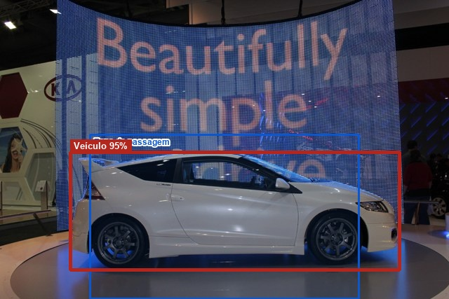

# Passo Livre: detector de obstáculos em calçadas

**FIAP · Global Solution 2026.2 · CitizenTech · Engenharia de Software · 4º ano · Turma 4ES**
**Disciplina:** Applied Computer Vision · **Professores:** Arnaldo Viana e Paulo Rodrigues

Detecção de objetos em tempo real, com treinamento customizado de YOLO, para avisar quem tem mobilidade reduzida sobre obstáculos na calçada.

## Integrantes e links

<!-- equipe:inicio -->
| Nome completo | RM |
|---|---|
| Gustavo Brisqui Martinez | 97969 |
| Guilherme Rezende Bezerra | 98508 |
| Matheus Brisqui Martinez | 97969 |

- **Vídeo de demonstração:** https://youtu.be/qj1O-sZHtjc
- **Repositório:** https://github.com/matheusbrisqui/gs_visao_computacional
<!-- equipe:fim -->

Documento da disciplina: [`docs/relatorio_visao_computacional.pdf`](docs/relatorio_visao_computacional.pdf)

## O problema e a solução

Pessoas com deficiência, idosos e responsáveis com carrinho de bebê encontram calçadas tomadas por veículos, lixo, postes e degraus. O **Passo Livre** é uma CitizenTech de acessibilidade e mobilidade urbana (ODS 10 e 11): um mapa colaborativo de obstáculos em calçadas e pontos de ônibus.

Este repositório é o componente de visão computacional do produto. Com a câmera apontada para o caminho, o sistema:

1. **detecta** os obstáculos com um modelo YOLO11n treinado pelo grupo;
2. **decide** se o objeto está no caminho, se bloqueia a passagem e qual a prioridade;
3. **avisa** na tela, em tempo real, e grava o alerta com a foto do momento;
4. opcionalmente, **cria o relato** no aplicativo Passo Livre, com o tipo de obstáculo já preenchido.



## Classes do modelo

| Classe | O que reúne (categorias do Open Images) | Tipo de relato no aplicativo |
|---|---|---|
| Veículo | Car, Van, Taxi, Truck | carro na calçada |
| Moto | Motorcycle | carro na calçada |
| Bicicleta | Bicycle | outro |
| Lixeira ou entulho | Waste container | entulho ou lixo |
| Poste ou placa | Street light, Traffic sign, Stop sign, Parking meter, Fire hydrant | poste ou obstáculo fixo |
| Escada ou degrau | Stairs | degrau sem rampa |
| Pessoa em cadeira de rodas | Wheelchair | não é obstáculo: eleva a prioridade do alerta |

## Resultados

<!-- resultados:inicio -->
Modelo YOLO11n ajustado com 1708 imagens (1323 de treino, 211 de validação e 174 de teste). Números medidos no conjunto de teste, com imagens de 416 pixels.

| Classe | Precisão | Revocação | mAP50 | mAP50-95 |
|---|---|---|---|---|
| Veículo | 0,911 | 0,575 | 0,675 | 0,509 |
| Moto | 0,898 | 0,535 | 0,746 | 0,543 |
| Bicicleta | 0,826 | 0,533 | 0,702 | 0,533 |
| Lixeira ou entulho | 0,915 | 0,824 | 0,849 | 0,771 |
| Poste ou placa | 0,751 | 0,311 | 0,386 | 0,308 |
| Escada ou degrau | 0,569 | 0,413 | 0,498 | 0,262 |
| Pessoa em cadeira de rodas | 0,834 | 0,800 | 0,861 | 0,499 |
| **Todas as classes** | **0,815** | **0,570** | **0,674** | **0,489** |

Velocidade no processador, sem placa de vídeo: detecção em 26 ms por quadro; aplicação completa a cerca de 30 quadros por segundo.
<!-- resultados:fim -->

Matriz de confusão, curvas e mais exemplos em [`assets/`](assets/). Histórico e parâmetros do treino em [`modelo/treino/`](modelo/treino/).

## Das detecções aos alertas

O modelo só informa que há um objeto em certa posição. As regras em [`src/passo_livre_visao/regras.py`](src/passo_livre_visao/regras.py) decidem o que isso significa para quem está passando:

| Regra | Como funciona |
|---|---|
| Zona de passagem | só conta o objeto cujo ponto de apoio cai na faixa central e inferior da imagem |
| Confiança mínima | detecções abaixo de 40% são ignoradas |
| Persistência | o obstáculo precisa aparecer em 8 dos últimos 12 quadros |
| Nível | cobre metade ou mais da largura da passagem: **bloqueio**; menos que isso: **atenção** |
| Prioridade | pessoa em cadeira de rodas na cena: prioridade **alta** |
| Intervalo | o mesmo tipo de obstáculo não repete alerta em menos de 8 segundos |

## Como executar

Requer Python 3.11 ou mais novo. O modelo treinado já está no repositório, então a detecção funciona logo depois da instalação.

```bash
python -m venv .venv
.venv\Scripts\activate            # Linux/macOS: source .venv/bin/activate
pip install -r requirements.txt
```

**Detecção em tempo real pela webcam** (tecla Q ou Esc para sair):

```bash
python visao.py camera
```

**Em um vídeo gravado**, por exemplo uma calçada filmada com o celular:

```bash
python visao.py video rua.mp4
```

**Em uma foto:**

```bash
python visao.py imagem foto.jpg
```

Opções úteis: `--confianca 0.5` muda a confiança mínima, `--gravar saida/demo.mp4` grava o vídeo com as caixas, `--indice 1` escolhe outra câmera. O endereço de uma câmera de rede (por exemplo, a câmera do celular por aplicativo de câmera IP) também serve como fonte do comando `video`.

Os alertas ficam em `saida/alertas_<execução>.jsonl`, e a foto de cada um em `saida/capturas/`.

**Integração com o aplicativo Passo Livre** (opcional): com o aplicativo no ar, cada alerta cria um relato novo.

```bash
python visao.py camera --enviar-para http://127.0.0.1:8000 --lat -23.5613 --lon -46.6558
```

No Windows há um atalho que acha o Python do projeto sozinho: `visao camera`, `visao video rua.mp4`, `visao testes`.

## Como reproduzir o treino

```bash
python visao.py dataset     # baixa as anotações e as imagens do Open Images e monta o conjunto
python visao.py treinar     # ajuste fino do YOLO11n (cerca de 1h40 em processador, sem placa de vídeo)
python visao.py avaliar     # mede no conjunto de teste e gera métricas, gráficos e exemplos
```

O conjunto de imagens não vai para o repositório. Ele é baixado para a pasta `dados/` (ou para a pasta indicada no arquivo `.dados_local` ou na variável `VISAO_DADOS`). O arquivo `ATRIBUICAO.csv`, gerado junto, lista autor e licença de cada imagem.

Para treinar em placa de vídeo, há um roteiro opcional para o Google Colab em [`notebooks/treino_colab.ipynb`](notebooks/treino_colab.ipynb).

**Fotos do grupo.** Para somar fotos próprias ao treino (por exemplo, de buracos, que o banco aberto não tem), coloque as imagens em `fotos_proprias/images/` e as anotações no formato YOLO em `fotos_proprias/labels/`, com os mesmos números de classe de [`classes.py`](src/passo_livre_visao/classes.py), e rode `python visao.py dataset` de novo. Uma classe nova precisa ser acrescentada em `classes.py`.

## Testes

```bash
python -m pytest -q
```

Os testes cobrem as regras de alerta (zona de passagem, persistência, nível, prioridade e intervalo), a preparação dos dados (leitura das anotações, seleção equilibrada, partição e formato YOLO) e o registro dos alertas. Rodam em segundos, sem câmera e sem o modelo.

## Estrutura

```
├── visao.py                 comando único do projeto
├── src/passo_livre_visao/
│   ├── classes.py           classes do modelo e sua relação com o aplicativo
│   ├── open_images.py       seleção das imagens e conversão das anotações
│   ├── montar_dataset.py    download e montagem do conjunto de treino
│   ├── treino.py            ajuste fino do YOLO11n
│   ├── avaliacao.py         métricas no conjunto de teste, gráficos e exemplos
│   ├── detector.py          carrega o modelo e devolve as detecções de um quadro
│   ├── regras.py            das detecções aos alertas
│   ├── tempo_real.py        laço da câmera, desenho na tela e gravação
│   └── registro.py          arquivo de alertas e envio opcional ao aplicativo
├── modelo/                  modelo treinado, métricas e evidências do treino
├── assets/                  gráficos da avaliação e exemplos de detecção
├── docs/                    documento em PDF, gerador e equipe.json
├── notebooks/               roteiro opcional de treino no Google Colab
└── tests/                   testes automatizados
```

## Privacidade e licenças

- As imagens da câmera ficam no computador de quem usa. Nada é enviado para fora, a não ser o relato opcional ao aplicativo, que leva só o tipo do obstáculo e a posição informada.
- O sistema não identifica pessoas. A classe de cadeira de rodas serve apenas para priorizar o alerta.
- Imagens de treino: [Open Images V7](https://storage.googleapis.com/openimages/web/index.html), imagens sob CC BY 2.0 e anotações sob CC BY 4.0. Créditos das fotos de exemplo em [`assets/CREDITOS.md`](assets/CREDITOS.md).
- Biblioteca de detecção: [Ultralytics YOLO](https://github.com/ultralytics/ultralytics), licença AGPL-3.0.

## Limitações

- O conjunto de treino vem de um banco internacional, e não de calçadas brasileiras.
- Não há classe para buraco, porque o banco aberto usado não tem essa categoria.
- As classes poste ou placa e escada ou degrau têm desempenho bem inferior às demais.
- A revocação é moderada: parte dos obstáculos não é vista, sobretudo os pequenos ou distantes.
- A zona de passagem é fixa e supõe a câmera apontada para a frente.
